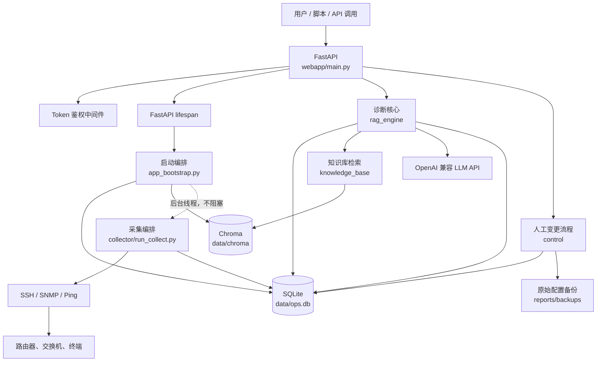
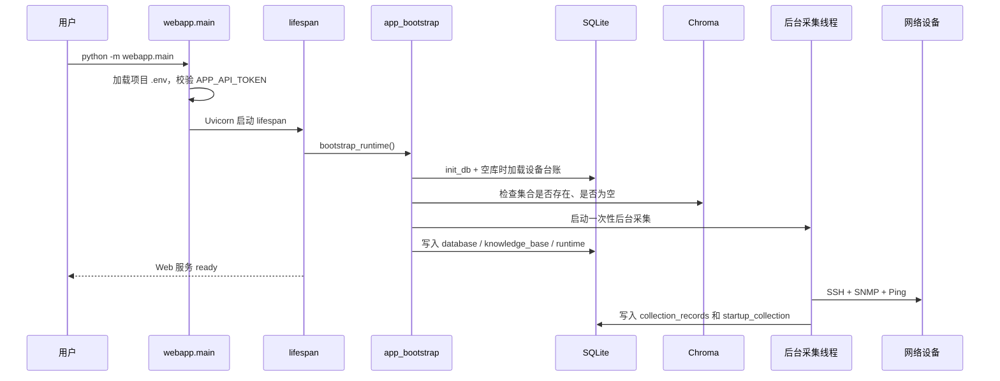
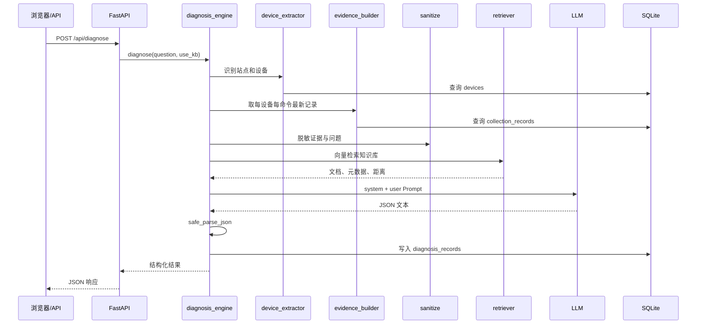
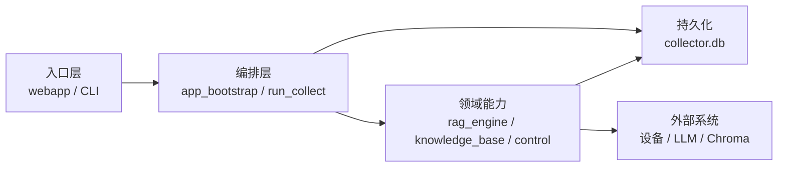
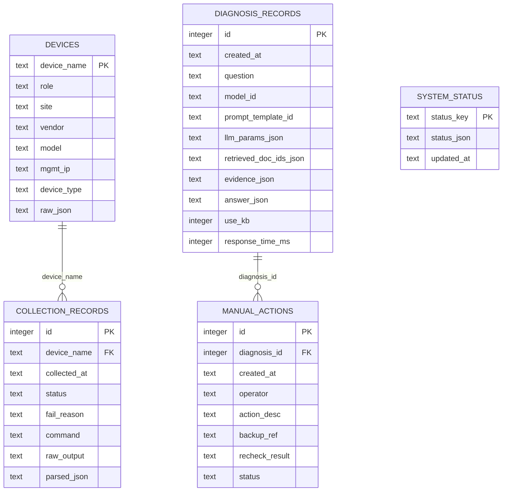

# 企业网络智能运维诊断系统

面向企业网络故障排查的单体应用：采集网络设备的真实状态作为证据，检索本地运维知识库，
再调用大模型生成可追溯、结构化的诊断建议。系统只自动执行只读检查，配置变更始终由人工确认、
人工在设备上执行，并在修复后复测。

> **维护基线（2026-10-20）**：Python 3.12、FastAPI、SQLite、Chroma 1.5.9、
> FastEmbed 0.9.0、`BAAI/bge-small-zh-v1.5`。快速测试基线为
> `41 passed, 1 deselected`，Ruff 与 compileall 通过。

---

## 目录

- [1. 快速开始](#1-快速开始)
- [2. 业务目标与核心场景](#2-业务目标与核心场景)
- [3. 系统架构全景](#3-系统架构全景)
- [4. 启动、诊断与人工变更链路](#4-启动诊断与人工变更链路)
- [5. 模块职责与依赖边界](#5-模块职责与依赖边界)
- [6. SQLite 数据模型](#6-sqlite-数据模型)
- [7. 知识库与本地 Embedding](#7-知识库与本地-embedding)
- [8. API 与页面](#8-api-与页面)
- [9. 配置项](#9-配置项)
- [10. 安全与操作边界](#10-安全与操作边界)
- [11. 开发、测试与排障](#11-开发测试与排障)
- [12. 修改定位地图](#12-修改定位地图)
- [13. 新人/Agent 阅读顺序](#13-新人agent-阅读顺序)
- [14. 已知限制与后续优化](#14-已知限制与后续优化)
- [15. 一句话记忆法](#15-一句话记忆法)

---

## 1. 快速开始

### 1.1 前置条件

- **Python 3.12 x64**。当前不建议直接升级到 3.13/3.14，`netmiko==4.3.0` 仍依赖
  `telnetlib`，且项目尚未在这些版本验证。
- 首次安装依赖、下载 Embedding 模型时需要网络。
- 真实采集需要设备 SSH/SNMP 可达；仅开发 Web/RAG 时可以关闭启动采集。
- 不需要 PyTorch、CUDA 或显卡。Embedding 使用 FastEmbed + ONNX Runtime CPU。

### 1.2 创建环境

Windows PowerShell：

```powershell
Set-Location "C:\path\to\-project6"
py -3.12 -m venv .venv
.\.venv\Scripts\Activate.ps1
python -m pip install --upgrade pip
python -m pip install -r requirements\dev.txt -r requirements\collect.txt
```

Linux/macOS：

```bash
python3.12 -m venv .venv
source .venv/bin/activate
python -m pip install --upgrade pip
python -m pip install -r requirements/dev.txt -r requirements/collect.txt
```

Windows 详细步骤见 [WINDOWS_DEVELOPMENT_GUIDE.md](WINDOWS_DEVELOPMENT_GUIDE.md)。

### 1.3 配置 `.env`

```bash
cp .env.example .env
```

Windows：

```powershell
Copy-Item .env.example .env
```

至少完成以下配置：

```dotenv
APP_API_TOKEN=<至少16位随机令牌>
LLM_API_KEY=<真实或测试用API Key>
LLM_BASE_URL=https://dashscope.aliyuncs.com/compatible-mode/v1
LLM_MODEL=qwen-plus

DEVICE_USERNAME=<设备账号>
DEVICE_PASSWORD=<设备口令>
SNMP_COMMUNITY=<只读团体字>
APP_AUTO_COLLECT=true

EMBEDDING_MODEL=BAAI/bge-small-zh-v1.5
FASTEMBED_CACHE_PATH=./models/fastembed
SQLITE_DB_PATH=./data/ops.db
CHROMA_DB_PATH=./data/chroma
```

注意：

- 应用只加载**项目根目录**的 `.env`，不会向上搜索父目录。
- `.env.example` 中的 `APP_API_TOKEN=CHANGE_ME` 不能通过启动校验，必须替换。
- `.env`、`data/`、`models/`、报告和备份均已被 `.gitignore` 排除。
- 不配置设备凭据也能启动 Web；启动采集状态会记录为 `skipped`。

### 1.4 构建知识库索引（首次运行）

```bash
python -m knowledge_base.build_index --rebuild
```

该命令读取 [knowledge_base/articles.json](knowledge_base/articles.json) 中的 26 篇资料，
使用本地 ONNX 模型写入 Chroma。首次运行会下载约 91 MiB 的模型文件。

索引不是 Web 启动的硬依赖：索引缺失或为空时服务仍会启动，运行状态标记为 `degraded`，
诊断降级为仅使用设备证据。

### 1.5 启动

```bash
python -m webapp.main
```

启动时自动执行：

1. 校验 `APP_API_TOKEN`；
2. 初始化 SQLite 并补齐表结构；
3. 数据库为空时加载 `network/device_inventory.json`；
4. 检查 Chroma 集合、模型和条目数量；
5. 在后台线程发起一次 SSH + SNMP + 连通性采集，不阻塞 Web 服务；
6. 将数据库、知识库、采集和整体状态写入 `system_status`。

浏览器访问 `http://127.0.0.1:8000`，输入 `APP_API_TOKEN` 登录。
开发时也可以使用：

```bash
python -m uvicorn webapp.main:app --host 127.0.0.1 --port 8000 --reload
```

### 1.6 启动后快速检查

```bash
python -m pytest -q
python -m ruff check .
```

查看数据库中的运行状态：

```bash
python -c "from collector import db; import json; print(json.dumps(db.list_system_status(), ensure_ascii=False, indent=2))"
```

查看知识库检索：

```bash
python -c "from knowledge_base.retriever import retrieve; print([h['id'] for h in retrieve('分支A路由器不通', top_k=4)])"
```

---

## 2. 业务目标与核心场景

### 2.1 解决的问题

传统网络排障容易依赖个人经验，且大模型容易出现“没有证据却给出确定结论”的问题。
本项目把诊断拆成三个可核查的部分：

1. **事实层**：设备最近的 SSH/SNMP/Ping 采集结果；
2. **方法层**：本地运维知识库检索结果；
3. **推理层**：大模型严格按照证据和资料生成结构化建议。

### 2.2 典型场景

- 查看总部/分支机构设备的最新采集状态。
- 输入“分支A路由器和交换机之间不通”，定位相关设备并诊断。
- 对比启用/禁用知识库时的诊断效果。
- 审核模型建议，自动备份设备配置，人工执行变更后复测。
- 导出包含证据、检索来源和建议的 Markdown 报告。

### 2.3 设计原则

| 原则 | 含义 |
|---|---|
| 证据优先 | 诊断 Prompt 只允许引用带设备名和采集时间的真实记录 |
| 本地优先 | Embedding、向量库、SQLite、报告均保存在本地 |
| 只读自动化 | 自动设备命令必须命中白名单 |
| 人工变更 | 系统不包含自动下发配置变更的代码路径 |
| 可追溯 | 保存模型、Prompt 模板、检索 ID、证据快照和响应耗时 |
| 可降级 | 知识库、LLM 或启动采集失败时，尽量保留 Web 与历史数据可用 |

---

## 3. 系统架构全景

这是模块化单体，不是微服务。Web、启动编排、采集、RAG 和人工流程运行在同一 Python
进程或同一代码仓中，通过普通函数调用协作；SQLite 和 Chroma 是本地持久化边界。



### 3.1 运行时特征

| 维度 | 当前实现 |
|---|---|
| 部署形态 | 单进程 FastAPI + 本地文件数据库 |
| Web 框架 | FastAPI + Jinja2 + 原生 `fetch` |
| 设备采集 | Netmiko SSH、PySNMP v2c、系统 `ping` |
| 关系数据 | SQLite，单文件 |
| 向量数据 | Chroma PersistentClient |
| Embedding | FastEmbed ONNX，本地 CPU |
| LLM | OpenAI Python SDK，兼容通义千问/DeepSeek 等 |
| 异步任务 | 仅启动采集使用 Python 后台线程，无消息队列 |
| 鉴权 | 单口令 Token；Header、Bearer 或 HttpOnly Cookie |
| 默认监听 | `127.0.0.1:8000` |

> **重要**：当前没有跨进程任务队列、构建锁或分布式锁。不要用多个 Uvicorn worker
> 同时运行启动采集，也不要让多个进程同时重建同一个 Chroma 集合。

---

## 4. 启动、诊断与人工变更链路

### 4.1 服务启动链路



关键行为：

- **Embedding 模型不阻塞启动**：启动检查只读集合和条目数量，不触发模型下载。
- **知识库缺失不阻止启动**：状态为 `missing/empty/error` 时，诊断仍可使用设备证据。
- **启动采集不阻塞启动**：采集在线程中运行，结果写入 `system_status.startup_collection`。
- **缺少设备凭据不阻止启动**：采集状态为 `skipped`，Web 仍可用。

### 4.2 诊断请求链路



诊断结果包含：

- `evidence`：本次使用的证据快照；
- `retrieved_docs`：知识库条目及距离；
- `knowledge_base.status`：`ready/error/empty/disabled`；
- `answer`：故障现象、原因、检查步骤、修复建议、复测方法；
- `model_id`、`prompt_template_id`、`response_time_ms`；
- `error`：仅表示 LLM 调用错误；知识库错误单独在 `knowledge_base.error`。

### 4.3 人工变更链路


系统不会把模型建议直接转换为配置命令并下发。`manual_change_workflow.py` 只负责：

1. 备份；
2. 记录确认、驳回或复测状态；
3. 将复测结果写回 `manual_actions` 和 `collection_records`。

---

## 5. 模块职责与依赖边界

### 5.1 分层关系



依赖方向应保持为“入口和编排可以依赖领域能力，领域模块通过 `collector.db` 读写状态”。
新增模块时不要在 `collector.db` 中反向导入 `webapp` 或 `rag_engine`，以免形成循环依赖。

当前有一个可优化点：`collector/collector_ssh.py` 从 `rag_engine.sanitize` 导入脱敏函数，
说明脱敏逻辑更像共享基础设施。后续可迁移到独立的 `common/sanitize.py`。

### 5.2 模块地图

| 模块 | 职责 | 关键入口 | 主要依赖 |
|---|---|---|---|
| `webapp/` | FastAPI 页面/API、鉴权、报告下载 | `webapp/main.py` | 启动、RAG、control、db |
| `app_bootstrap.py` | 启动准备、状态检查、后台采集调度 | `bootstrap_runtime()` | db、collector、knowledge_base |
| `project_config.py` | 只加载项目根 `.env`，布尔配置解析 | `load_project_env()`、`env_flag()` | python-dotenv |
| `collector/` | 设备台账、SSH/SNMP/Ping 采集、SQLite 访问 | `run_collect.py`、`db.py` | Netmiko、PySNMP、sqlite3 |
| `knowledge_base/` | 文章、Embedding、建索引、检索 | `build_index.py`、`retriever.py` | Chroma、FastEmbed |
| `rag_engine/` | 设备识别、证据构建、Prompt、LLM、脱敏 | `diagnosis_engine.py` | db、retriever、OpenAI |
| `control/` | 只读校验、配置备份、人工变更状态机 | `manual_change_workflow.py` | db、Netmiko |
| `network/` | 设备台账静态数据 | `device_inventory.json` | 无 |
| `test_cases/` | 10 个故障场景与 KB 对比演示 | `compare_kb.py` | 全链路 |
| `tests/` | 单元、启动、鉴权、慢速检索测试 | `pytest` | pytest |

### 5.3 核心文件阅读优先级

| 优先级 | 文件 | 为什么 |
|---|---|---|
| ⭐⭐⭐ | [webapp/main.py](webapp/main.py) | 所有页面、API 和 lifespan 入口 |
| ⭐⭐⭐ | [app_bootstrap.py](app_bootstrap.py) | 启动自动准备、状态和后台采集 |
| ⭐⭐⭐ | [collector/db.py](collector/db.py) | 唯一持久化入口和完整数据结构 |
| ⭐⭐⭐ | [rag_engine/diagnosis_engine.py](rag_engine/diagnosis_engine.py) | RAG 主干流程 |
| ⭐⭐ | [collector/run_collect.py](collector/run_collect.py) | 采集编排与结果摘要 |
| ⭐⭐ | [knowledge_base/build_index.py](knowledge_base/build_index.py) / [retriever.py](knowledge_base/retriever.py) | 向量库读写 |
| ⭐⭐ | [webapp/security.py](webapp/security.py) | 所有请求的鉴权边界 |
| ⭐ | [control/manual_change_workflow.py](control/manual_change_workflow.py) | 人工变更状态机 |

---

## 6. SQLite 数据模型

数据库路径：`SQLITE_DB_PATH`，默认 `data/ops.db`。所有访问都应经过
[collector/db.py](collector/db.py)，不要在业务模块中直接拼接 SQLite 连接。

### 6.1 ER 图



> 诊断记录与采集记录之间没有物理外键。诊断时会把所用证据复制进
> `diagnosis_records.evidence_json`，形成历史快照，避免后续采集覆盖导致诊断依据变化。

### 6.2 `devices`：设备台账缓存

用途：把 `network/device_inventory.json` 同步到数据库，供设备识别、页面展示和采集复用。

| 字段 | 类型 | 说明 |
|---|---|---|
| `device_name` | TEXT PK | 设备唯一名称，如 `BR-A-R2` |
| `role` | TEXT | 设备角色 |
| `site` | TEXT | 站点，如“总部”“分支A” |
| `vendor` / `model` | TEXT | 厂商和型号 |
| `mgmt_ip` | TEXT | 管理 IP |
| `device_type` | TEXT | Netmiko 类型，如 `cisco_ios` |
| `raw_json` | TEXT | 完整台账 JSON，包含 SSH/SNMP 端口和接口列表 |

启动时只有 `devices` 为空才会从台账加载；已有设备不会被删除。

### 6.3 `collection_records`：采集事实表

用途：追加保存每一次 SSH 命令、SNMP 轮询、Ping 和人工复测结果。

| 字段 | 说明 |
|---|---|
| `id` | 自增主键，也是“最近一次”的主要排序依据 |
| `device_name` | 关联设备名 |
| `collected_at` | ISO8601 时间，带本地时区偏移 |
| `status` | `success` / `failed` |
| `fail_reason` | 失败原因 |
| `command` | 原命令；SNMP 使用 `SNMP:ifTable+sysUpTime`，Ping 使用 `ping <ip>` |
| `raw_output` | 原始文本或 SNMP 解析文本 |
| `parsed_json` | 结构化结果 JSON 字符串 |

索引：`(device_name, collected_at DESC)`。

“最新”逻辑：

- 总览页 `get_all_latest_status()` 使用 `MAX(id) GROUP BY device_name, command`；
- 单设备 `get_latest_record()` 使用 `ORDER BY collected_at DESC`；
- 诊断证据按 `device_name + command` 取最大 `id`。

表没有 `(device_name, command, collected_at)` 唯一约束，重复采集会产生新行。当前没有自动清理策略。

### 6.4 `diagnosis_records`：诊断审计表

| 字段 | 说明 |
|---|---|
| `question` | 原始用户问题 |
| `model_id` | 实际使用的 LLM 模型 |
| `prompt_template_id` | Prompt 版本，如 `diagnosis_v1` |
| `llm_params_json` | 模型、temperature、max_tokens 等 |
| `retrieved_doc_ids_json` | 本次命中的知识库 ID 列表 |
| `evidence_json` | 本次证据快照 |
| `answer_json` | 模型结构化 JSON |
| `use_kb` | 是否请求启用知识库；1/0 |
| `response_time_ms` | 模型调用耗时 |

这张表是**审计记录**，不应在读取历史诊断时重新查询实时设备证据。

### 6.5 `manual_actions`：人工处置状态

| 状态 | 含义 |
|---|---|
| `confirmed` | 已确认且配置备份成功，等待人工变更 |
| `backup_failed` | 备份失败，不能继续变更 |
| `completed` | 人工变更后复测成功 |
| `recheck_failed` | 复测仍失败 |
| `rejected` | 人工驳回模型建议 |

`backup_ref` 指向 `reports/backups/<device>_<timestamp>.cfg`，保存原始运行配置。

### 6.6 `system_status`：运行状态快照

键值表，每行是一组 JSON 状态。当前写入四类键：

| `status_key` | 内容 |
|---|---|
| `database` | 数据库是否就绪、设备数、台账是否导入、路径、警告 |
| `knowledge_base` | `ready/missing/empty/error`、集合名、模型、条目数、路径、检查时间 |
| `startup_collection` | 采集状态、时间、模式、SSH/SNMP 成功失败数、缺失设备、错误 |
| `runtime` | 数据库与知识库的聚合状态：`ready/degraded`，并包含启动采集当时的快照 |

`startup_collection.status` 可能为：

`running`、`success`、`partial`、`failed`、`skipped`、`disabled`。

`runtime` 暂时只根据数据库和知识库判定是否 `degraded`；启动采集失败记录在独立的
`startup_collection` 键中，不会把整个 Web 服务标记为不可用。

这些状态目前只写入数据库，尚未提供 App 查询接口或页面，见 [TODO.md](TODO.md)。

### 6.7 数据一致性与当前限制

- 每次数据库操作创建独立连接，提交后关闭。
- 建表使用 `CREATE TABLE IF NOT EXISTS`，**没有迁移框架**；字段变更需自行提供迁移方案。
- 表结构声明了外键，但连接未执行 `PRAGMA foreign_keys=ON`，外键目前不具强制约束力。
- SQLite 适合当前单机规模；不适合多实例并发写和长期无清理的高频采集。
- 备份文件含设备原始配置；数据库诊断证据在入库前脱敏，但备份文件本身是原始配置。

---

## 7. 知识库与本地 Embedding

### 7.1 文章数据

[knowledge_base/articles.json](knowledge_base/articles.json) 当前有 26 篇资料：

| 类别 | 数量 |
|---|---:|
| VLAN | 5 |
| 路由 | 5 |
| DHCP | 4 |
| ACL | 5 |
| 接口故障 | 5 |
| 通用排查方法 | 2 |

每篇包含：`id`、`title`、`category`、`content`、`applicable_device`、`version`、`source`。

### 7.2 建索引


集合名固定为 `ops_knowledge_base`。写入时保存文档、向量和元数据。

### 7.3 检索

`retrieve(query, top_k, category_filter)`：

1. 加载持久化集合；
2. 集合不存在或为空时抛出 `KnowledgeBaseUnavailable`；
3. 使用同一 Embedding 模型编码查询；
4. 返回 `id/title/category/applicable_device/version/source/content/distance`。

### 7.4 模型一致性

- 建索引和查询必须使用同一个 embedding 模型和缓存。
- 更换模型、实现或 collection 配置后必须 `--rebuild`。
- `FASTEMBED_CACHE_PATH` 默认示例为 `./models/fastembed`。
- 模型缓存完整后，可设置 `HF_HUB_OFFLINE=1` 做离线验证。
- 启动检查只读取集合数量，不会下载模型；真正的模型加载发生在首次建索引或查询。

---

## 8. API 与页面

### 8.1 鉴权

除 `/login`、`/logout`、`/static/*` 外，所有请求都经过 Token 中间件。

支持：

- `Authorization: Bearer <token>`
- `X-API-Token: <token>`
- 登录后 HttpOnly Cookie

### 8.2 页面

| 路径 | 作用 |
|---|---|
| `/login` | 输入访问口令 |
| `/` | 设备台账与最新采集状态 |
| `/device/{device_name}` | 单设备最近 50 条采集记录 |
| `/diagnose` | 提交诊断、查看历史和人工处理 |
| `/api/export/{id}` | 下载 Markdown 诊断报告 |

### 8.3 JSON API

| 方法 | 路径 | 请求/响应 |
|---|---|---|
| `POST` | `/api/diagnose` | `{question, use_kb}` → 诊断结果 |
| `GET` | `/api/diagnoses` | 最近诊断列表 |
| `GET` | `/api/diagnosis/{id}` | 诊断详情 + 人工操作记录 |
| `POST` | `/api/manual/confirm` | `{diagnosis_id, device_name, operator, action_desc}` |
| `POST` | `/api/manual/recheck` | `{action_id, source_device_name, target_ip, operator}` |
| `POST` | `/api/manual/reject` | `{diagnosis_id, operator, reason}` |

接口文档默认关闭；仅在开发时设置 `APP_ENABLE_DOCS=true`。

### 8.4 诊断响应示例

```json
{
  "diagnosis_id": 12,
  "question": "分支A路由器和交换机之间不通",
  "model_id": "qwen-plus",
  "prompt_template_id": "diagnosis_v1",
  "use_kb": true,
  "evidence": [
    {
      "device_name": "BR-A-R2",
      "collected_at": "2026-10-20T10:30:00+08:00",
      "status": "success",
      "command": "show ip interface brief",
      "summary": "..."
    }
  ],
  "retrieved_docs": [
    {
      "id": "KB-VLAN-003",
      "title": "VLAN间路由缺失子接口或SVI导致跨VLAN不通",
      "distance": 0.61
    }
  ],
  "knowledge_base": {
    "status": "ready",
    "error": null
  },
  "answer": {
    "fault_phenomenon": "...",
    "possible_causes": [],
    "check_steps": [],
    "fix_suggestions": [],
    "recheck_method": "...",
    "missing_information": "..."
  },
  "response_time_ms": 1830,
  "error": null
}
```

---

## 9. 配置项

完整模板见 [.env.example](.env.example)。

| 分组 | 变量 | 作用 |
|---|---|---|
| LLM | `LLM_API_KEY` / `LLM_BASE_URL` / `LLM_MODEL` | OpenAI 兼容接口 |
| Embedding | `EMBEDDING_MODEL` | FastEmbed 模型名 |
| Embedding | `FASTEMBED_CACHE_PATH` | 模型缓存目录 |
| 设备 | `DEVICE_USERNAME` / `DEVICE_PASSWORD` | SSH 采集和配置备份 |
| 设备 | `SNMP_COMMUNITY` | SNMPv2c 只读团体字 |
| 设备 | `SSH_LEGACY_ALGOS` | 老 Cisco SHA-1 算法兼容 |
| 启动 | `APP_AUTO_COLLECT` | 是否后台执行启动采集，默认 `true` |
| 远程网络 | `ZEROTIER_NETWORK_ID` / `EVE_MGMT_IP` / `EVE_MGMT_ROUTE_CIDR` | Linux 远程实验网辅助脚本 |
| Web | `APP_HOST` / `APP_PORT` | 监听地址和端口 |
| Web | `APP_API_TOKEN` | 必填访问令牌，长度 ≥ 16 |
| Web | `APP_ENABLE_DOCS` / `APP_RELOAD` | 文档与热重载 |
| 存储 | `SQLITE_DB_PATH` | SQLite 文件路径 |
| 存储 | `CHROMA_DB_PATH` | Chroma 持久化目录 |

项目配置由 [project_config.py](project_config.py) 统一加载。不要在各模块里再次使用无参数
`load_dotenv()`，否则可能向上搜索到其他项目的 `.env`。

`DB_PATH`、Chroma 路径、Embedding 模型名和缓存路径都在模块导入时读取；修改 `.env` 后应重启
Python 进程。`APP_RELOAD=true` 只用于开发环境。

---

## 10. 安全与操作边界

| 边界 | 当前实现 |
|---|---|
| 凭据 | 仅 `.env`，不进入 Git |
| 监听 | 默认仅本机 `127.0.0.1` |
| 鉴权 | 单 Token，常量时间比较 |
| 接口文档 | 默认关闭 |
| 自动设备命令 | 必须命中 `collector/whitelist_commands.py` |
| 配置变更 | 不下发，只生成建议和人工流程记录 |
| 诊断证据 | 发送 LLM 前脱敏 |
| 批量 SSH 输出 | 写 SQLite 前脱敏 |
| 配置备份 | 原始配置保存在 `reports/backups/` |

当前需要注意的实现细节：

- `control/readonly_executor.py` 是一条独立只读执行路径，尚未调用 `sanitize_text()` 再写
  `raw_output`。启用到 Web 操作前应先补齐脱敏和测试。
- `os.chmod(600)` 在 Windows 上不能替代 NTFS ACL；敏感备份应额外设置 Windows 权限。
- 登录 Cookie 保存的是同一访问令牌，适合当前单用户/受控环境，不等同于多用户身份系统。

---

## 11. 开发、测试与排障

### 11.1 常用命令

```bash
python -m pytest
python -m pytest -m slow -vv
python -m ruff check .
python -m compileall -q collector rag_engine knowledge_base control webapp app_bootstrap.py project_config.py
```

测试默认使用临时 SQLite 和 Chroma，并设置 `APP_AUTO_COLLECT=false`，不会连接真实设备。

### 11.2 测试分层

| 层 | 内容 |
|---|---|
| 纯函数 | 脱敏、白名单、设备识别、证据过期、JSON 解析 |
| 编排 | 数据库/知识库启动检查、后台采集状态、采集摘要 |
| 配置 | 项目 `.env` 不回退父目录 |
| Web | Token 鉴权、登录 Cookie、页面和静态资源 |
| 慢测试 | 真实构建 26 条索引并检索，需要模型缓存 |

### 11.3 推荐排障顺序

1. `python -c "import sys; print(sys.executable)"` 是否指向项目 `.venv`。
2. `python -m pip check` 是否有依赖冲突。
3. `python -m pytest -q` 是否通过。
4. 查看 `system_status` 的 `database`、`knowledge_base`、`startup_collection`。
5. 单独验证 Chroma 检索。
6. 先用 `use_kb=false` 验证 LLM，再启用知识库。
7. 用 `Test-NetConnection` / SSH / SNMP 检查设备网络。
8. 最后启动 Web，用 API Token 做冒烟测试。

### 11.4 常见故障

| 现象 | 优先检查 |
|---|---|
| 启动报 Token 错误 | 项目根 `.env`、`APP_API_TOKEN` 长度 |
| 知识库 `missing/empty` | `python -m knowledge_base.build_index --rebuild` |
| Embedding 下载失败 | 代理、`FASTEMBED_CACHE_PATH`、模型缓存完整性 |
| 启动采集 `skipped` | `DEVICE_USERNAME` / `DEVICE_PASSWORD` |
| 启动采集 `failed/partial` | ZeroTier、路由、22/161 端口、设备凭据 |
| 检索报集合不可用 | 建索引和查询是否使用同一模型/路径 |
| LLM 调用失败 | `LLM_API_KEY`、`LLM_BASE_URL`、模型名、网络 |
| 页面无设备 | 数据库是否已加载台账；查看 `system_status.database` |
| 诊断历史正常但证据旧 | 查看 `collected_at` 和 `is_stale`，重新采集 |

### 11.5 演示与效果对比

```bash
python -m test_cases.compare_kb
python -m test_cases.demo_e2e
```

`compare_kb` 会使用隔离的临时 SQLite/Chroma，对比 10 个场景在
`use_kb=True/False` 下的结果，默认仍需要有效 LLM Key 才能得到真实模型输出。

真实排障演示：

1. 连接实验室网络；
2. 启动服务或手动执行 `python -m collector.run_collect`；
3. 在 EVE-NG 中制造故障；
4. 再次采集；
5. 提交自然语言诊断；
6. 人工确认并备份；
7. 人工在设备上修复；
8. 复测并导出报告。

### 11.6 CI

[.github/workflows/ci.yml](.github/workflows/ci.yml) 包含：

- `ruff check` + `compileall`；
- `pytest`；
- Web 导入和启动准备冒烟；
- `gitleaks` 密钥扫描；
- 手动触发的知识库索引构建产物。

---

## 12. 修改定位地图

| 需求 | 主要修改位置 | 同步事项 |
|---|---|---|
| 新增设备类型 | `network/device_inventory.json`、`collector/whitelist_commands.py` | 检查 Netmiko 类型、SNMP、页面展示 |
| 新增采集命令 | `collector/whitelist_commands.py`、`collector_ssh.py` | 更新白名单测试 |
| 新增采集来源 | `collector/`、`run_collect.py` | 扩展摘要和 `startup_collection` 状态 |
| 新增知识文章 | `knowledge_base/articles.json` | `--rebuild` 并增加检索测试 |
| 更换 Embedding 模型 | `.env`、`knowledge_base/` | 清理旧集合、完整重建、离线验证 |
| 修改诊断流程 | `rag_engine/diagnosis_engine.py` | 同步证据、Prompt、响应字段和测试 |
| 修改 Prompt 结构 | `rag_engine/prompt_templates.py` | 更新模板 ID 和前端渲染/报告导出 |
| 新增页面/API | `webapp/main.py`、`webapp/templates/` | 鉴权自动生效，补 Web 测试 |
| 新增数据库字段 | `collector/db.py` 的 `SCHEMA` 和访问函数 | 增加迁移、写入方、读取方、测试 |
| 修改启动行为 | `webapp/main.py` lifespan、`app_bootstrap.py` | 更新启动状态和测试 |
| 新增配置 | `.env.example`、`project_config` 使用方 | README 和安全说明 |
| 修改人工变更流程 | `control/manual_change_workflow.py` | `manual_actions` 状态和 UI |

### 12.1 改动时必须保持的不变量

1. 不得把模型输出直接当作设备事实；证据必须来自 `collection_records`。
2. 不得新增自动配置下发路径；变更必须经过人工确认和备份。
3. 不得绕过 `collector/whitelist_commands.py` 执行自动设备命令。
4. 建索引和查询必须使用同一 Embedding 模型/路径。
5. 业务模块应通过 `collector/db.py` 访问 SQLite。
6. 项目入口必须使用 `project_config.load_project_env()`，禁止读取父目录 `.env`。
7. 修改数据库结构后必须考虑已有 `data/ops.db` 的迁移。
8. 修改诊断响应结构时同步更新模板、报告导出和测试。

---

## 13. 新人/Agent 阅读顺序

### 13.1 30 分钟建立主干认知

| 顺序 | 文件 | 目标 | 预计 |
|---|---|---|---|
| 1 | 本 README 的 3-4 节 | 知道进程、存储、启动和诊断链路 | 10 min |
| 2 | [webapp/main.py](webapp/main.py) | 找到所有 API、lifespan 和页面入口 | 5 min |
| 3 | [app_bootstrap.py](app_bootstrap.py) | 理解启动准备和后台采集 | 5 min |
| 4 | [collector/db.py](collector/db.py) | 掌握五张表和唯一数据入口 | 10 min |
| 5 | [rag_engine/diagnosis_engine.py](rag_engine/diagnosis_engine.py) | 串起一次诊断调用 | 5 min |

### 13.2 理解诊断数据流

```text
用户问题
  → device_extractor 识别站点/设备
  → evidence_builder 读取最新采集事实
  → sanitize 脱敏
  → retriever 检索运维文章
  → prompt_templates 组装 Prompt
  → llm_client 调用兼容接口
  → safe_parse_json 解析
  → diagnosis_records 保存审计快照
```

### 13.3 Agent 操作约定

- 始终从项目根目录运行命令；默认解释器为 `.venv\Scripts\python.exe`。
- 跑快速测试时保持 `APP_AUTO_COLLECT=false`，避免真实设备连接。
- 测试使用临时 `SQLITE_DB_PATH` / `CHROMA_DB_PATH`，不要污染真实数据。
- 修改 KB 或 embedding 后必须重建索引，并跑一次 `pytest -m slow`。
- 不要把真实 Token、设备口令、API Key 写入源码或日志。
- 涉及设备操作的改动，先确认是否仍满足“只读/人工确认”边界。
- 修改 API 返回值时同步检查 Jinja 模板中的原生 JavaScript。

### 13.4 文件树

```text
.
├── app_bootstrap.py              # 启动准备、状态、后台采集
├── project_config.py             # 项目 .env 显式加载
├── webapp/                       # FastAPI、模板、鉴权、报告导出
├── collector/                    # 台账、SSH/SNMP/Ping、SQLite
├── knowledge_base/               # 文章、Embedding、Chroma 检索
├── rag_engine/                   # 设备识别、证据、Prompt、LLM
├── control/                      # 只读执行、备份、人工流程
├── network/device_inventory.json # 设备唯一静态台账
├── test_cases/                   # 10 场景对比和 E2E 演示
├── tests/                        # pytest
├── requirements/                 # base/build/collect/dev 分层依赖
└── data/                         # 运行产物：ops.db、chroma
```

---

## 14. 已知限制与后续优化

当前更适合单机、单用户或受控演示环境。主要技术债：

- 知识库状态、初始化、重建和文章管理还没有 App 页面/API，见 [TODO.md](TODO.md)。
- 启动采集是进程内 daemon 线程，没有持久任务、重试、取消和多 worker 协调。
- 没有数据库迁移框架，`CREATE TABLE IF NOT EXISTS` 不会自动升级旧表。
- SQLite 外键声明尚未通过 `PRAGMA foreign_keys=ON` 启用。
- `collection_records` 和诊断记录目前没有保留期限、归档或清理策略。
- `control/readonly_executor.py` 写库前尚未统一脱敏。
- 单设备采集串行执行，设备多时启动采集会持续较长时间。
- LLM 调用是同步 OpenAI SDK；当前依赖 FastAPI 线程池，尚未做流式/异步任务。
- `system_status.startup_collection` 已有持久化状态，但还没有查询 API 和页面。
- Windows 配置备份的文件权限仍需通过 NTFS ACL 加固。

相关文档：

- [Windows 运行与调试指南](WINDOWS_DEVELOPMENT_GUIDE.md)
- [知识库管理 TODO](TODO.md)
- [环境变量模板](.env.example)

---

## 15. 一句话记忆法

> **采集模块负责“看见事实”，知识库负责“提供方法”，RAG 负责“组织推理”，
> SQLite 负责“留下证据”，Web 负责“操作与审计”，control 负责“守住变更边界”。**
