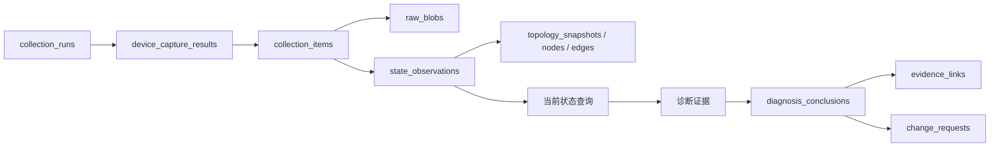
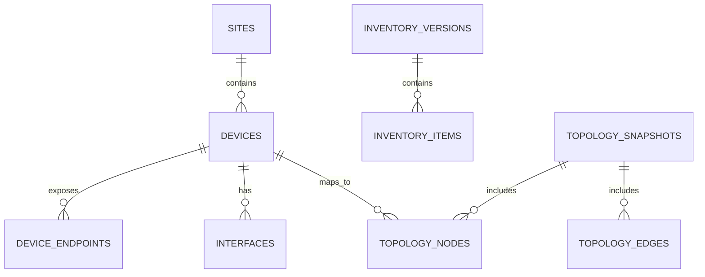
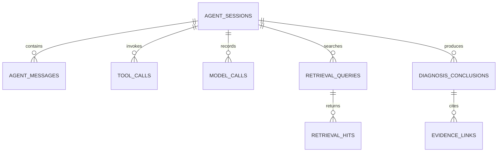

# 数据库设计

## 1. 概览

系统使用 SQLite 保存设备台账、采集证据、诊断审计、知识版本、人工变更和运行状态。
Chroma 单独保存向量索引，两者通过文章版本和内容哈希关联。

当前迁移版本为 6：

| 版本 | 迁移 |
|---|---|
| 1 | 资产、采集批次和状态事实 |
| 2 | 时间字段统一为 UTC |
| 3 | 诊断会话、工具调用、检索和证据 |
| 4 | 人工变更和操作记录 |
| 5 | 知识版本、评测、权限和保留策略 |
| 6 | 控制台后台任务和人工终端审计 |

## 2. 核心数据链



一条主链对应一次可追溯的采集：

1. 一次任务是一条 `collection_runs`。
2. 每台设备产生一条 `device_capture_results`。
3. 每个 SSH 命令、SNMP 轮询或 Ping 是一条 `collection_items`。
4. 原始输出保存在 `raw_blobs`，解析后的事实进入 `state_observations`。
5. 只有已发布的采集批次可以成为当前状态来源。

## 3. 资产与拓扑



| 表 | 责任 |
|---|---|
| `sites` | 站点树和时区 |
| `devices` | 当前设备身份、站点、角色和生命周期 |
| `device_aliases` | 设备别名 |
| `device_endpoints` | SSH、SNMP、Ping 管理入口 |
| `interfaces` | 稳定接口身份 |
| `credential_refs` | 凭据引用，不保存明文 |
| `inventory_versions` / `inventory_items` | 台账导入、导出和变更快照 |
| `topology_snapshots` | 某次采集生成的拓扑版本 |
| `topology_nodes` / `topology_edges` | 拓扑节点和带证据来源的链路 |

`devices` 是运行时权威台账。`network/device_inventory.json` 只在数据库没有设备时作为
首次种子。

## 4. 采集与状态事实

| 表 | 责任 |
|---|---|
| `command_policies` | 自动命令白名单和策略 |
| `raw_blobs` | 原始命令、SNMP 或 Ping 输出 |
| `collection_runs` | 批次、触发方式、范围、发布状态和汇总 |
| `device_capture_results` | 单台设备在批次中的结果 |
| `collection_items` | 单个采集通道或命令 |
| `state_observations` | 解析后的接口、路由、邻居、VLAN、可达性等事实 |
| `config_snapshots` | 配置快照及哈希 |

关键规则：

- `collection_runs.published_at_utc` 非空才可作为当前状态来源。
- 设备本轮不可达时，不返回该设备历史接口或路由事实。
- 每条状态事实包含设备、采集项、类型、时间和来源。
- 未采集使用 `unknown`，不能推断为故障。
- 旧 `collection_records` 以兼容视图保留，新代码不写入该视图。

## 5. 诊断与证据



| 表 | 责任 |
|---|---|
| `prompt_versions` | Prompt 模板版本 |
| `agent_sessions` / `agent_messages` | 会话及消息 |
| `context_snapshots` | 模型输入上下文 |
| `tool_registry` / `tool_calls` / `tool_call_results` | 只读工具与调用审计 |
| `model_calls` | 模型、耗时、Token 和请求结果 |
| `kb_chunks` | 本地知识块映射 |
| `retrieval_queries` / `retrieval_hits` | 检索查询与命中 |
| `diagnosis_conclusions` | 结构化结论 |
| `evidence_links` | 结论到设备事实、知识版本和工具结果的引用 |

诊断结论必须区分设备事实、知识依据和模型判断。引用的证据在生成时固化，文章后续修改不会
改变历史诊断。

## 6. 人工变更与复测

| 表 | 责任 |
|---|---|
| `change_requests` | 变更请求、风险和建议结论 |
| `change_steps` | 软件或物理步骤 |
| `change_approvals` | 审批记录 |
| `change_events` | 状态事件时间线 |
| `command_executions` | 人工软件步骤执行记录 |
| `physical_actions` | 人工物理操作记录 |
| `config_backups` | 配置备份元数据和哈希 |
| `rechecks` | 修复后复测结果 |
| `attachments` | 请求附件元数据 |
| `health_checks` | 检查结果 |
| `audit_log` | 通用操作审计 |
| `reports` | 导出报告 |

系统不存在“模型建议直接执行配置变更”的数据路径。变更必须经过人工审批、备份、执行记录
和复测。

## 7. 知识与治理

| 表 | 责任 |
|---|---|
| `knowledge_sources` | 资料来源 |
| `knowledge_articles` | 文章身份和当前版本 |
| `knowledge_article_versions` | 内容版本、哈希和适用平台 |
| `embedding_models` | 模型元数据 |
| `knowledge_index_versions` | Chroma 索引版本和发布状态 |
| `users` / `roles` / `permissions` | 角色权限模型 |
| `user_roles` / `role_permissions` | 关联关系 |
| `test_suites` / `test_cases` | 评测场景 |
| `fault_injections` | 故障注入定义 |
| `experiment_runs` / `experiment_results` | 有/无知识库评测 |
| `retention_policies` | 保留策略 |
| `maintenance_runs` | 维护任务记录 |

评测结果同时保存证据哈希、准确率、可执行性、耗时和错误。保留策略默认只做 dry-run，
不自动删除审计和业务证据。

## 8. 控制台平台

| 表 | 责任 |
|---|---|
| `application_settings` | 采集计划和非敏感界面配置 |
| `background_jobs` | 采集、知识构建等长任务 |
| `terminal_sessions` | 人工终端会话和备份确认 |
| `terminal_events` | 命令、输出、错误和会话事件 |

终端命令在发送给设备前先落库，传输失败也能追溯。应用关闭时统一回收活跃 SSH channel。

## 9. 一致性与约束

- 主键使用稳定字符串 ID，外键开启 SQLite 约束检查。
- 所有跨系统时间保存为 UTC，浏览器负责本地化展示。
- 软退役设备保留历史采集、诊断和终端记录。
- 设备、批次和证据的关联不能通过名称猜测，必须使用稳定 ID。
- 原始输出可去重；解析事实独立保存，允许解析规则升级后重放。
- JSON 字段用于扩展属性，不替代高频筛选所需的正式列和索引。
- 表结构只能通过新迁移改变，不回写旧迁移。

## 10. 迁移与维护

显式执行迁移：

```powershell
python -m collector.migrate
```

迁移流程应：

1. 检查数据库路径和当前版本；
2. 在写入前备份旧数据库；
3. 按版本顺序执行幂等迁移；
4. 检查外键和关键表数量；
5. 保留旧表或兼容视图直到业务验证完成。

升级前同时备份 SQLite、Chroma 和 `.env`。数据量增长后，可优先评估当前状态查询的
物化表或缓存层，再决定是否迁移到外部数据库。
