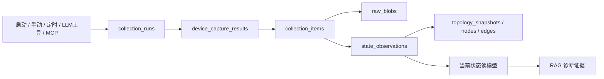
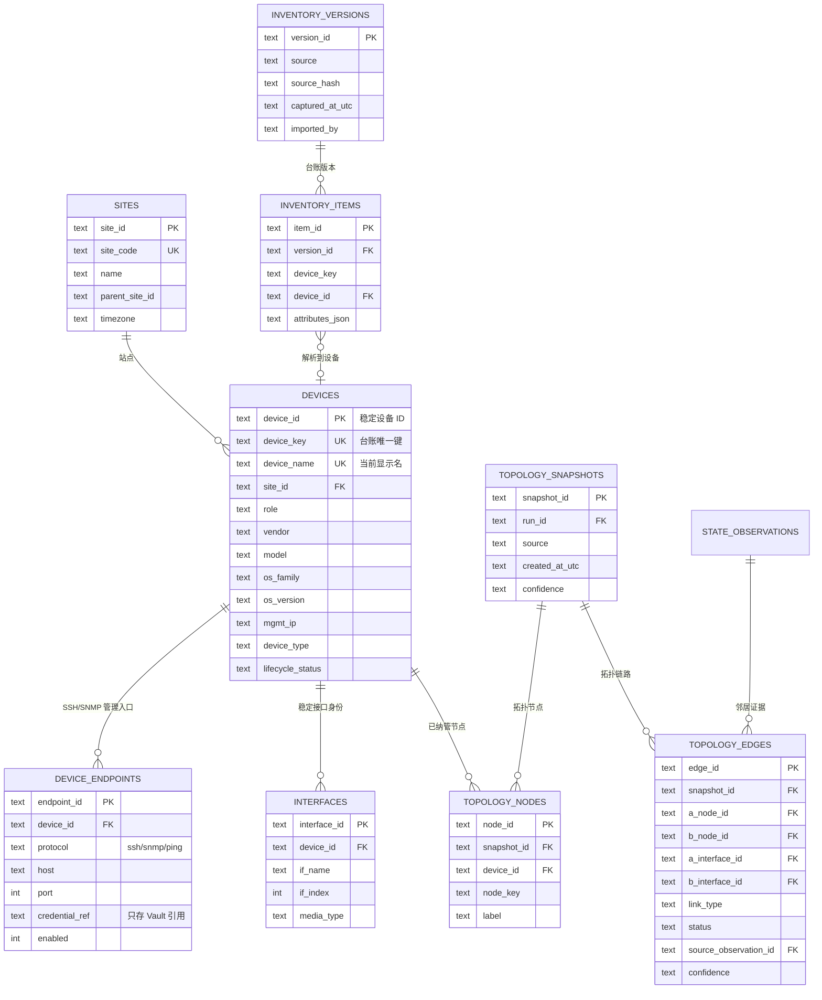
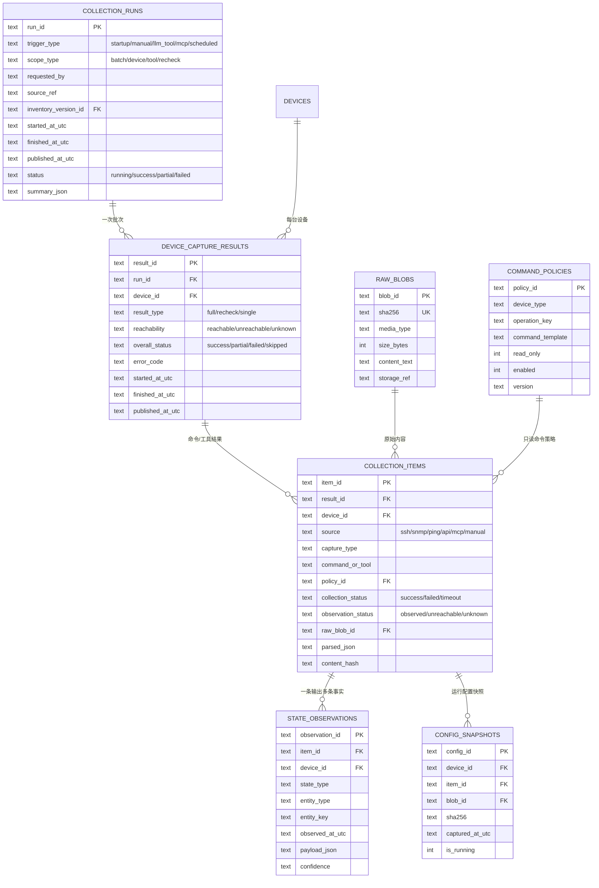

# 一期数据库结构设计

本文描述企业网络智能运维诊断系统一期已经落地的数据模型。一期的目标是先把
**资产、采集批次、设备结果、采集项和状态事实**建立成可追溯的数据链，同时保留
旧版诊断、人工处理和运行状态表，确保现有页面与诊断流程继续工作。

> 当前实现版本：`schema_migrations.version = 2`。版本 1 为
> `phase1_asset_collection_state`，版本 2 为 `normalize_utc_timestamps`。

## 1. 设计目标

一期解决以下问题：

- 一次采集不再是一组互相独立的“最新命令记录”，而是一个有开始、结束和发布时间的完整批次。
- 批量采集、指定设备采集、人工复测以及未来的 LLM/MCP 工具调用共用同一个采集模型。
- SSH、SNMP、Ping 等原始输出与解析后的状态事实分开保存。
- 接口、路由、VLAN、ACL、邻居、可达性和配置都能成为独立状态事实，为拓扑构建和诊断提供证据。
- 最近一次设备不可达时，当前状态返回 `unknown`，不再沿用历史成功状态。
- 旧 `collection_records` 表保留为兼容视图，迁移期间现有页面和测试不中断。

## 2. 总体数据流



核心规则：

1. 每台设备在一次任务中有一条 `device_capture_results`。
2. 每个 SSH 命令、SNMP 轮询或 Ping 是一条 `collection_items`。
3. 每条采集项可以解析出多条 `state_observations`。
4. 只有 `collection_runs.published_at_utc` 非空的任务才会成为当前状态来源。
5. 设备本轮不可达时，当前状态只返回不可达事实；接口、路由等旧成功事实不参与当前诊断。

## 3. 资产、接口与拓扑



台账版本通过 `inventory_versions` 和 `inventory_items` 保留历史。`devices` 只保存
当前设备身份；接口的稳定身份放在 `interfaces`，接口状态则保存在
`state_observations`，二者不混用。

`topology_snapshots` 是某次采集生成的拓扑快照。CDP 解析出的邻居先进入
`state_observations(state_type='neighbor')`，再由拓扑构建器生成节点和链路。
拓扑边保留 `source_observation_id`，可以回到原始采集证据。

## 4. 采集批次与状态事实



### 4.1 一次采集的生命周期

1. 调用 `start_collection_run()` 创建 `running` 批次。
2. 每台设备创建一条 `device_capture_results`，初始为 `running/unknown`。
3. SSH、SNMP、Ping 返回后，每条结果写入 `collection_items`，并解析为
   `state_observations`。
4. 设备完成后更新 `reachability` 和 `overall_status`。
5. 全部设备完成后写入 `finished_at_utc`、`published_at_utc` 和批次摘要。
   所有新表时间统一转换为 UTC；旧库迁移时会执行一次时间归一化。
6. 只有已发布批次通过 `get_current_device_bundle()` 进入当前状态和 RAG 证据。

### 4.2 状态类型

`state_observations` 是通用事实表，当前支持：

| `state_type` | 典型 `entity_key` | 内容 |
|---|---|---|
| `reachability` | 目标 IP | 源设备到目标是否可达 |
| `interface` | `Ethernet0/0.10` | admin/oper 状态、IP、ifIndex |
| `route` | `0.0.0.0/0` | 协议、下一跳、出接口、管理距离 |
| `vlan` | `VLAN10` | 名称、状态、端口列表 |
| `acl` | `BLOCK_BRANCH` | ACL 规则顺序和动作 |
| `neighbor` | `cdp:Ethernet0/0:HQ-R1` | CDP/LLDP 邻居和远端接口 |
| `arp` | `10.10.10.100` | MAC、接口 |
| `system` | `sysUpTime` | 在线状态和运行时间 |
| `config` | `running-config` | 配置行数、哈希和摘要 |
| `command_output` | 命令名 | 暂未专门解析的原始输出 |

接口状态优先按 `entity_key` 去重；例如 SSH 的接口 IP 与 SNMP 的
admin/oper 状态可以合并，而不是让后到的 SNMP 结果覆盖掉 SSH 的 IP。

## 5. 当前状态读模型

当前不直接使用 `MAX(collection_items.id)`。当前状态查询规则是：

1. 每台设备选择最近一次已发布的 `full` 或 `single` 结果；
2. 如果没有，再使用最近的 `recheck` 结果；
3. `recheck` 比全量采集更新时，优先使用它的可达性事实；
4. 本轮 `reachability=unreachable` 时，接口、路由等旧成功事实不返回；
5. 没有采集记录的设备返回 `no_data`，不编造状态。

对应函数：

- `get_current_device_bundle(device_name)`：单设备结果、采集项和状态事实。
- `get_current_state(device_names)`：扁平化状态事实，供诊断和工具查询。
- `get_current_device_status()`：设备级可达性、总体状态和最近采集时间。
- `get_all_latest_status()`：兼容旧页面，返回当前批次的采集项。

## 6. 旧表迁移与兼容

首次运行 `python -m collector.migrate` 或启动应用时，`db.init_db()` 会：

1. 将旧数据库备份为 `<db>.pre-phase1-<timestamp>.bak`；
2. 把旧 `devices` 改名为 `devices_legacy`；
3. 把旧 `collection_records` 改名为 `collection_records_legacy`；
4. 创建新资产、采集和状态表；
5. 从旧表生成一个 `trigger_type='migration'` 的采集批次；
6. 修复旧 SSH `parsed_json` 的双重 JSON 编码；
7. 解析旧原始输出为状态事实，并生成拓扑快照；
8. 把所有时间归一化为 UTC，避免 `+08:00` 与 `+00:00` 的字符串排序错误；
9. 创建 `collection_records` 兼容视图。

兼容视图字段：

`id`、`device_name`、`collected_at`、`status`、`fail_reason`、`command`、
`raw_output`、`parsed_json`。

旧 `collection_records_legacy` 和 `devices_legacy` 不会被删除，可用于对照审计。

## 7. 索引与 SQLite 约定

一期索引包括：

```text
devices(site_id)
interfaces(device_id, if_name)
inventory_items(version_id)
collection_runs(started_at_utc DESC)
collection_runs(published_at_utc DESC)
device_capture_results(device_id, published_at_utc DESC)
device_capture_results(run_id)
collection_items(result_id, started_at_utc)
collection_items(device_id, started_at_utc DESC)
state_observations(device_id, state_type, observed_at_utc DESC)
state_observations(item_id)
topology_edges(snapshot_id)
```

SQLite 约定：

- 每个连接执行 `PRAGMA foreign_keys=ON`；
- 数据库使用 WAL；
- 新表时间统一 UTC；
- 原始输出通过 `raw_blobs.sha256` 去重；
- 大配置后续可把 `raw_blobs.content_text` 迁到对象存储，数据库只保留哈希和引用；
- `schema_migrations` 记录结构版本，后续迁移应按版本追加，不可直接修改旧表。

## 8. 后续阶段预留

一期只实现采集与证据基础。后续建议增加：

- `agent_sessions`、`agent_messages`、`context_snapshots`：完整会话和模型上下文；
- `tool_registry`、`tool_calls`、`tool_call_results`：LLM/MCP 工具调用；
- `model_calls`、`retrieval_queries`、`retrieval_hits`：模型和知识库审计；
- `diagnosis_conclusions`、`evidence_links`：诊断结论到状态事实的引用；
- `change_requests`、`change_steps`、`change_approvals`、`change_events`：
  人工变更状态机；
- `command_executions`、`physical_actions`、`config_backups`、`rechecks`：
  软件命令、物理操作、配置备份和复测证据；
- `test_suites`、`test_cases`、`fault_injections`、`experiment_runs`、
  `experiment_results`：故障注入与效果评测；
- `kb_sources`、`kb_articles`、`kb_article_versions`、`kb_chunks`：
  知识库版本和来源；
- `health_checks`、`audit_log`：运行健康检查和操作审计。

这些表在一期中只作为设计边界保留，尚未在代码中实现。
